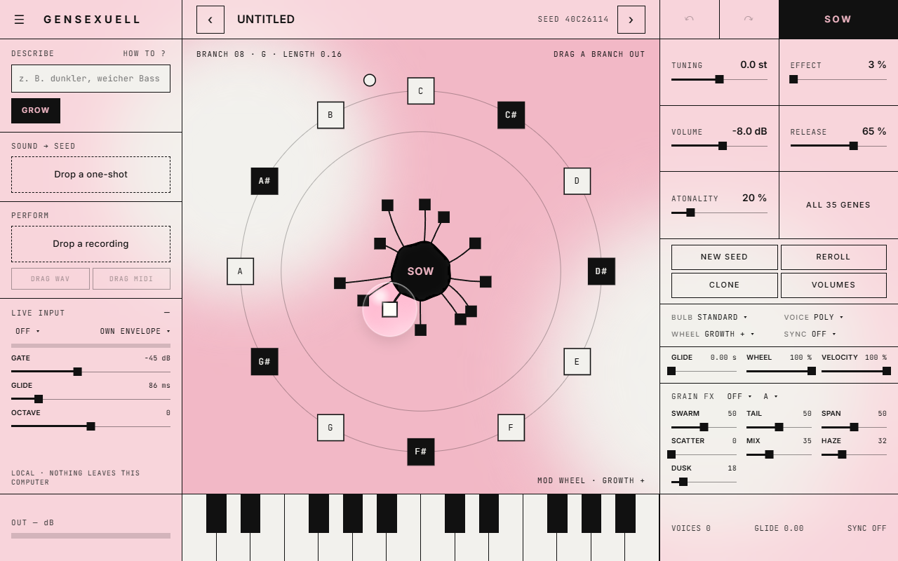

# gensexuell

[](https://github.com/Beatsex/gensexuell/actions/workflows/build.yml) [](LICENSE) 

[English](README.md) · **Deutsch** · [Español](README.es.md) · [Français](README.fr.md) · [日本語](README.ja.md)

Ein Synthesizer, den du aus einem Samen wachsen lässt, von **beatsexuell**.
VST3, CLAP und LV2 für Windows und macOS, AU für macOS, dazu eine eigenständige App. Alles läuft auf deinem Rechner: keine Cloud, kein Konto, keine Internetverbindung.

> Klänge wachsen lassen, keine Songs generieren.



## Funktionen

- **Drei Wege zum Klang**
  - **Wachsen lassen**: 12 Äste um einen Samen, je länger, desto weiter vom Original. Säen, klonen, neu würfeln, rückgängig.
  - **Beschreiben**: Auf Deutsch oder Englisch eintippen (*„dunkler, weicher Bass“*, *„glassy pluck, not too bright“*). gensexuell sucht Samen, die wirklich so klingen. Vier Takes pro Klick.
  - **Sample mitbringen**: One-Shot reinziehen. Ein neuronales Netz schätzt die Gene, vier Stränge verfeinern den Treffer, während du zuhörst.
- **Performance → Seed**: Eine einstimmige Aufnahme reinziehen (Gesang, Summen, Bass). Noten, Timing, Dynamik und Bends werden erkannt und mit dem aktuellen Samen gespielt. Das Ergebnis als WAV oder MIDI in die DAW ziehen.
- **Live-Eingang**: Audio auf den Sidechain routen und den Synth in Echtzeit mit Stimme oder Instrument spielen.
- **54 Gene** im Gen-Editor, an ihren Enden mit Ringmodulation, Wavefolding und gestufter Zufallstonhöhe
- **Bulb-Modi** (Standard, Velocity, Bereiche, Layer), Poly / Mono / Legato mit Glide, Ast-Lautstärken
- **Mod-Wheel-Ring** mit zehn Zielen, Tempo-Sync, MPE-Grundlagen
- **Grain-Effekte** aus [grainsexuell](https://github.com/Beatsex/grainsexuell): Mosaic, Cloud, Shard, Tap, dazu Haze-Hall und Dusk-Tiefpass
- **Patches**: 12 Werksklänge, Patch-Dateien, Programme, **MIDI Learn**
- Bildschirmtastatur, Ausgangsanzeige, skalierbares Fenster

## Installation

Den neuesten Build gibt es unter [Releases](https://github.com/Beatsex/gensexuell/releases).

| System | So geht's |
|---|---|
| Windows 10 / 11 (64 Bit) | `gensexuell-…-win64-setup.exe` starten. Die Beta ist noch nicht signiert: Wenn SmartScreen warnt, *Weitere Informationen* → *Trotzdem ausführen*. Die Oberfläche braucht die Microsoft WebView2 Runtime. Windows 11 hat sie dabei, und das Setup sagt Bescheid, falls sie fehlt. |
| macOS | `gensexuell.vst3` nach `~/Library/Audio/Plug-Ins/VST3`, `gensexuell.component` nach `~/Library/Audio/Plug-Ins/Components` und `gensexuell.clap` nach `~/Library/Audio/Plug-Ins/CLAP` kopieren. Der macOS-Build ist noch nicht von Hand getestet. |

Dann die DAW neu starten (oder Plugins neu scannen) und als Instrument einfügen: *beatsexuell → gensexuell*.

## Schnellstart

1. Ein paar Töne spielen, auf dem Keyboard oder den Tasten im Fenster.
2. Einen Ast aus dem Samen ziehen. Je länger der Ast, desto weiter wandert der Klang.
3. Etwas Gutes gefunden? Mit **SOW** zum neuen Samen machen und wiederholen.
4. Oder links *„dunkler weicher Bass“* eintippen und **GROW** klicken.
5. Oder einen One-Shot auf **Sound → Seed** ziehen.

Gute Beschreibungen schreiben: der [Describe-Leitfaden](docs/DESCRIBE.de.md). Den Parser ausprobieren und alle Wörter durchsuchen: der [interaktive Leitfaden](https://beatsex.github.io/gensexuell/de.html).

Das ausführliche [Handbuch](https://beatsex.github.io/gensexuell/handbuch.html) ist online und liegt jedem Download bei ([englisch](https://beatsex.github.io/gensexuell/manual.html)).

## Aus dem Quellcode bauen

Voraussetzungen: CMake 3.22+, ein C++20-Compiler (Visual Studio 2022 oder Xcode). JUCE 8 und clap-juce-extensions kommen nach `libs/`, in den Versionen aus [`.github/workflows/build.yml`](.github/workflows/build.yml). Windows braucht außerdem das NuGet-Paket `Microsoft.Web.WebView2` in Version `1.0.3485.44` in `libs/nuget`.

```
cmake -B build -G "Visual Studio 17 2022" -A x64   # oder: cmake -B build -DCMAKE_BUILD_TYPE=Release
cmake --build build --config Release -j
ctest --test-dir build -C Release --output-on-failure
```

Das Plugin landet in `build/Seedling_artefacts/Release/`. Unter Windows erledigt `build.cmd` das alles mit den Visual Studio Build Tools.

Windows-Installer: `py installer\make-source.py`, dann `"C:\Program Files (x86)\Inno Setup 6\ISCC.exe" installer\gensexuell.iss`. Das Setup landet in `build\installer`.

Das Sound → Seed-Netz wird an der Engine selbst trainiert: `tools\dataset.cmd 150000`, dann `py tools/train/train.py`. Neu trainieren, wenn sich die Gene oder die Stimmen-DSP ändern.

## Feedback

Ein [Issue](https://github.com/Beatsex/gensexuell/issues) aufmachen, mit Patch oder Seed, was du gespielt und was du gehört hast, DAW und Samplerate. Bei einem Absturz: welche DAW und was du zuletzt geklickt hast.

## Lizenz

[GNU AGPL v3](LICENSE) © beatsexuell. Du darfst gensexuell benutzen, ändern und weitergeben. Wer es weitergibt, verändert oder nicht, gibt auch den Quellcode weiter.

Es nutzt JUCE 8 unter der AGPLv3-Option, clap-juce-extensions (MIT), die grainsexuell-Effekte (MIT) und die Schriften Inter und JetBrains Mono (SIL OFL 1.1), siehe [THIRD-PARTY-LICENSES.txt](THIRD-PARTY-LICENSES.txt).
