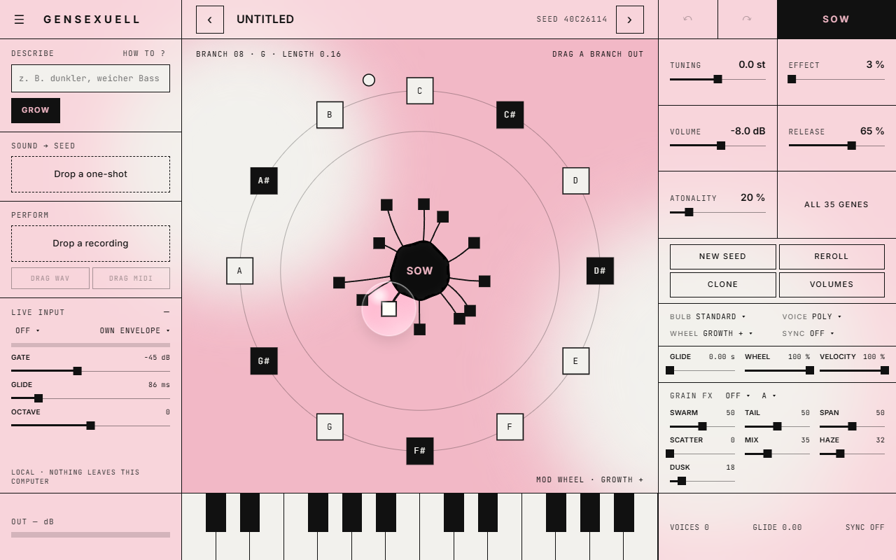

# gensexuell

[](https://github.com/Beatsex/gensexuell/actions/workflows/build.yml) [](LICENSE) 

[English](README.md) · [Deutsch](README.de.md) · **Español** · [Français](README.fr.md) · [日本語](README.ja.md)

Un sintetizador que haces crecer a partir de una semilla, de **beatsexuell**.
VST3, CLAP y LV2 en Windows y macOS, AU en macOS, además de una aplicación independiente. Todo se ejecuta en tu ordenador: sin nube, sin cuenta, sin conexión a internet.

> Haz crecer sonidos, no generes canciones.



## Funciones

- **Tres caminos hacia un sonido**
  - **Hazlo crecer**: 12 ramas alrededor de una semilla; cuanto más larga la rama, más lejos del original. Sembrar, clonar, volver a tirar, deshacer.
  - **Descríbelo**: escribe lo que quieres en alemán o inglés (*"dark, soft bass"*, *"wärmeres Pad mit viel Raum"*). gensexuell busca semillas que suenen realmente así. Cuatro tomas por clic.
  - **Trae una muestra**: suelta un one-shot. Una red neuronal estima los genes y cuatro hebras afinan el resultado mientras escuchas.
- **Interpretación → semilla**: suelta una grabación monofónica (voz, tarareo, bajo). Detecta notas, tiempos, dinámica y bends y los toca con la semilla actual. Arrastra el resultado a tu DAW como WAV o MIDI.
- **Entrada en directo**: envía audio al sidechain y toca el sintetizador con tu voz o un instrumento en tiempo real.
- **35 genes** en un editor, con modulación en anillo, wavefolding y tono aleatorio escalonado en sus extremos
- **Modos de bulbo** (estándar, velocidad, rangos, capas), poly / mono / legato con glide, volumen por rama
- **Anillo de rueda de modulación** con diez destinos, sincronización de tempo, MPE básico
- **Efectos granulares** de [grainsexuell](https://github.com/Beatsex/grainsexuell): Mosaic, Cloud, Shard, Tap, además de la reverb Haze y el paso bajo Dusk
- **Patches**: 12 sonidos de fábrica, archivos de patch, programas, **MIDI learn**
- Teclado en pantalla, medidor de salida, ventana redimensionable

## Instalación

Descarga la última versión en [Releases](https://github.com/Beatsex/gensexuell/releases).

| Sistema | Cómo |
|---|---|
| Windows 10 / 11 (64 bits) | Ejecuta `gensexuell-…-win64-setup.exe`. La beta aún no está firmada: si aparece SmartScreen, haz clic en *Más información* → *Ejecutar de todas formas*. La interfaz necesita Microsoft WebView2 Runtime; Windows 11 ya lo incluye y el instalador te avisa si falta. |
| macOS | Copia `gensexuell.vst3` a `~/Library/Audio/Plug-Ins/VST3`, `gensexuell.component` a `~/Library/Audio/Plug-Ins/Components` y `gensexuell.clap` a `~/Library/Audio/Plug-Ins/CLAP`. La versión de macOS aún no se ha probado a mano. |

Después reinicia tu DAW (o vuelve a escanear los plugins) e insértalo como instrumento: *beatsexuell → gensexuell*.

## Inicio rápido

1. Toca unas notas, en tu teclado o en las teclas de la ventana.
2. Arrastra una rama fuera de la semilla. Cuanto más larga, más cambia el sonido.
3. ¿Encontraste uno que te gusta? Haz clic en **SOW** para convertirlo en la nueva semilla y repite.
4. O escribe *"dark soft bass"* a la izquierda y haz clic en **GROW**.
5. O suelta un one-shot en **Sound → Seed**.

Cómo escribir buenas descripciones: la [guía de Describe](docs/DESCRIBE.md) (en inglés).

El manual completo ([`installer/USER_MANUAL.html`](installer/USER_MANUAL.html), en inglés) viene con cada descarga.

## Compilar desde el código

Requisitos: CMake 3.22+, un compilador C++20 (Visual Studio 2022 o Xcode). JUCE 8 y clap-juce-extensions van en `libs/`, en las versiones fijadas en [`.github/workflows/build.yml`](.github/workflows/build.yml). Windows también necesita el paquete NuGet `Microsoft.Web.WebView2` versión `1.0.3485.44` en `libs/nuget`.

```
cmake -B build -G "Visual Studio 17 2022" -A x64   # o: cmake -B build -DCMAKE_BUILD_TYPE=Release
cmake --build build --config Release -j
ctest --test-dir build -C Release --output-on-failure
```

El plugin queda en `build/Seedling_artefacts/Release/`. En Windows, `build.cmd` hace todo esto con las Visual Studio Build Tools.

## Comentarios

Abre un [issue](https://github.com/Beatsex/gensexuell/issues) con el patch o la semilla, lo que tocaste, lo que oíste, tu DAW y la frecuencia de muestreo. Si hay un fallo: qué DAW y qué pulsaste por última vez.

## Licencia

[GNU AGPL v3](LICENSE) © beatsexuell. Puedes usar, cambiar y compartir gensexuell; quien lo distribuya, modificado o no, distribuye también el código fuente.

Usa JUCE 8 bajo su opción AGPLv3, clap-juce-extensions (MIT), los efectos de grainsexuell (MIT) y las fuentes Inter y JetBrains Mono (SIL OFL 1.1), ver [THIRD-PARTY-LICENSES.txt](THIRD-PARTY-LICENSES.txt).
