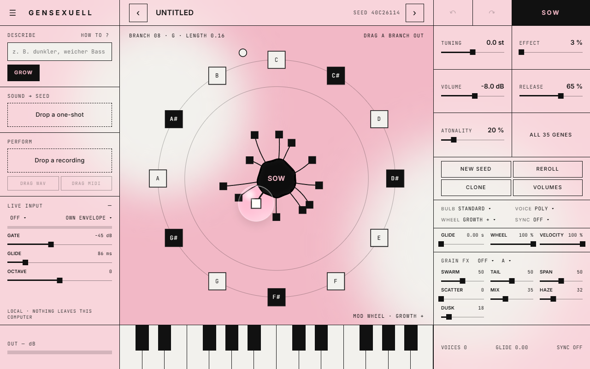

# gensexuell

[](https://github.com/Beatsex/gensexuell/actions/workflows/build.yml) [](LICENSE) 

[English](README.md) · [Deutsch](README.de.md) · [Español](README.es.md) · **Français** · [日本語](README.ja.md)

Un synthétiseur que l'on fait pousser à partir d'une graine, par **beatsexuell**.
VST3, CLAP et LV2 sous Windows et macOS, AU sous macOS, plus une application autonome. Tout tourne sur votre ordinateur : pas de cloud, pas de compte, pas de connexion internet.

> Faites pousser des sons, ne générez pas de chansons.



## Installation

Téléchargez la dernière version depuis [Releases](https://github.com/Beatsex/gensexuell/releases).

| Système | Comment |
|---|---|
| Windows 10 / 11 (64 bits) | Lancez `gensexuell-…-win64-setup.exe`. La bêta n'est pas encore signée : si SmartScreen apparaît, cliquez sur *Informations complémentaires* → *Exécuter quand même*. L'interface a besoin de Microsoft WebView2 Runtime ; Windows 11 l'inclut, et l'installateur vous prévient s'il manque. |
| macOS | Copiez `gensexuell.vst3` dans `~/Library/Audio/Plug-Ins/VST3`, `gensexuell.component` dans `~/Library/Audio/Plug-Ins/Components` et `gensexuell.clap` dans `~/Library/Audio/Plug-Ins/CLAP`. La version macOS n'a pas encore été testée à la main. |

Redémarrez ensuite votre DAW (ou relancez le scan des plugins) et insérez-le comme instrument : *beatsexuell → gensexuell*.

## Démarrage rapide

1. Jouez quelques notes, sur votre clavier ou sur les touches de la fenêtre.
2. Tirez une branche hors de la graine. Plus elle est longue, plus le son change.
3. Un son vous plaît ? Cliquez sur **SOW** pour en faire la nouvelle graine, et recommencez.
4. Ou tapez *« dark soft bass »* à gauche et cliquez sur **GROW**.
5. Ou déposez un one-shot sur **Sound → Seed**.

## Documentation

- **Manuel** : [en ligne](https://beatsex.github.io/gensexuell/manual.html) (en anglais ; en allemand : [Handbuch](https://beatsex.github.io/gensexuell/handbuch.html)). Les deux accompagnent aussi chaque téléchargement.
- **Décrire des sons** : le [guide Describe](docs/DESCRIBE.md) et le [guide interactif](https://beatsex.github.io/gensexuell/) pour essayer l’analyseur et parcourir tous les mots (en anglais).
- **Ce qui a changé** : [CHANGELOG.md](CHANGELOG.md) (en anglais).

## Fonctions

- **Trois chemins vers un son**
  - **Faites-le pousser** : 12 branches autour d'une graine ; plus la branche est longue, plus on s'éloigne de l'original. Semer, cloner, relancer, annuler.
  - **Décrivez-le** : tapez ce que vous voulez en allemand ou en anglais (*« dark, soft bass »*, *« wärmeres Pad mit viel Raum »*). gensexuell cherche des graines qui sonnent vraiment ainsi. Quatre prises par clic.
  - **Apportez un sample** : déposez un one-shot. Un réseau de neurones estime les gènes, quatre brins affinent le résultat pendant que vous écoutez.
- **Interprétation → graine** : déposez un enregistrement monophonique (voix, fredonnement, basse). Notes, timing, dynamique et bends sont détectés puis joués avec la graine actuelle. Glissez le résultat dans votre DAW en WAV ou MIDI.
- **Entrée live** : envoyez de l'audio sur le sidechain et jouez du synthé avec votre voix ou un instrument en temps réel.
- **58 gènes** dans un éditeur, avec modulation en anneau, wavefolding et hauteur aléatoire par paliers à leurs extrémités
- **Modes de bulbe** (standard, vélocité, zones, couches), poly / mono / legato avec glide, volume par branche
- **Anneau de molette de modulation** avec dix cibles, synchro au tempo, bases MPE
- **Effets granulaires** de [grainsexuell](https://github.com/Beatsex/grainsexuell) : Mosaic, Cloud, Shard, Tap, plus la réverbe Haze et le passe-bas Dusk
- **Patches** : 12 sons d'usine, fichiers de patch, programmes, **MIDI learn**
- Clavier à l'écran, indicateur de sortie, fenêtre redimensionnable

## Retours

Ouvrez une [issue](https://github.com/Beatsex/gensexuell/issues) avec le patch ou la graine, ce que vous avez joué, ce que vous avez entendu, votre DAW et la fréquence d'échantillonnage. En cas de crash : quel DAW et votre dernier clic.

## Compiler depuis les sources

Prérequis : CMake 3.22+, un compilateur C++20 (Visual Studio 2022 ou Xcode). JUCE 8 et clap-juce-extensions vont dans `libs/`, aux versions fixées dans [`.github/workflows/build.yml`](.github/workflows/build.yml). Windows a aussi besoin du paquet NuGet `Microsoft.Web.WebView2` version `1.0.3485.44` dans `libs/nuget`.

```
cmake -B build -G "Visual Studio 17 2022" -A x64   # ou : cmake -B build -DCMAKE_BUILD_TYPE=Release
cmake --build build --config Release -j
ctest --test-dir build -C Release --output-on-failure
```

Le plugin se trouve dans `build/Seedling_artefacts/Release/`. Sous Windows, `build.cmd` fait tout cela avec les Visual Studio Build Tools.

## Licence

[GNU AGPL v3](LICENSE) © beatsexuell. Vous pouvez utiliser, modifier et partager gensexuell ; quiconque le transmet, modifié ou non, transmet aussi le code source.

Il utilise JUCE 8 sous son option AGPLv3, clap-juce-extensions (MIT), les effets de grainsexuell (MIT) et les polices Inter et JetBrains Mono (SIL OFL 1.1), voir [THIRD-PARTY-LICENSES.txt](THIRD-PARTY-LICENSES.txt).
