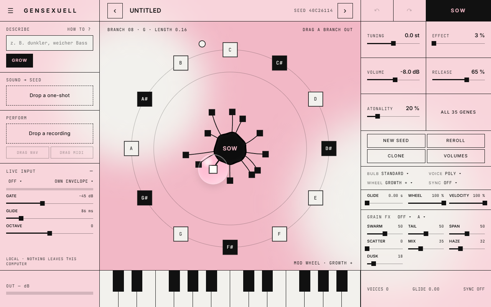

# gensexuell

[](https://github.com/Beatsex/gensexuell/actions/workflows/build.yml) [](LICENSE) 

[English](README.md) · [Deutsch](README.de.md) · [Español](README.es.md) · [Français](README.fr.md) · **日本語**

種から音を育てるシンセサイザー。制作：**beatsexuell**。
Windows と macOS の VST3・CLAP・LV2、macOS の AU、スタンドアロンアプリに対応。すべてお使いのコンピューター上で動作します。クラウドもアカウントもインターネット接続も不要です。

> 音を育てよう。曲を生成するのではなく。



## 機能

- **音を作る 3 つの方法**
  - **育てる**：種のまわりに 12 本の枝。枝が長いほど元の音から離れます。種まき、複製、再抽選、取り消しが可能です。
  - **言葉で伝える**：欲しい音をドイツ語か英語で入力します（*"dark, soft bass"*、*"wärmeres Pad mit viel Raum"*）。gensexuell は実際にそのように鳴る種を探します。1 クリックで 4 テイク。
  - **サンプルを持ち込む**：ワンショットをドロップします。ニューラルネットが遺伝子を推定し、聴いている間に 4 本のストランドが精度を高めます。
- **演奏 → 種**：モノフォニックの録音（ボーカル、ハミング、ベース）をドロップすると、音符、タイミング、強弱、ベンドを検出し、現在の種で演奏します。結果は WAV または MIDI として DAW にドラッグできます。
- **ライブ入力**：サイドチェーンにオーディオを送り、声や楽器でリアルタイムにシンセを演奏できます。
- エディターで編集できる **35 の遺伝子**。値の端ではリングモジュレーション、ウェーブフォールド、ステップ状のランダムピッチになります
- **バルブモード**（標準、ベロシティ、レンジ、レイヤー）、ポリ／モノ／レガート＋グライド、枝ごとの音量
- 10 種類のターゲットを持つ**モッドホイールリング**、テンポ同期、MPE の基本機能
- [grainsexuell](https://github.com/Beatsex/grainsexuell) の**グラニュラーエフェクト**：Mosaic、Cloud、Shard、Tap、さらに Haze リバーブと Dusk ローパス
- **パッチ**：ファクトリーサウンド 12 種、パッチファイル、プログラム、**MIDI ラーン**
- 画面上の鍵盤、出力メーター、サイズ変更可能なウィンドウ

## インストール

最新のビルドは [Releases](https://github.com/Beatsex/gensexuell/releases) からダウンロードできます。

| システム | 方法 |
|---|---|
| Windows 10 / 11（64 ビット） | `gensexuell-…-win64-setup.exe` を実行します。ベータ版はまだコード署名されていません。SmartScreen が表示されたら *詳細情報* → *実行* をクリックしてください。画面表示には Microsoft WebView2 Runtime が必要です。Windows 11 には含まれており、不足している場合はセットアップが知らせます。 |
| macOS | `gensexuell.vst3` を `~/Library/Audio/Plug-Ins/VST3` に、`gensexuell.component` を `~/Library/Audio/Plug-Ins/Components` に、`gensexuell.clap` を `~/Library/Audio/Plug-Ins/CLAP` にコピーします。macOS 版はまだ手動でテストされていません。 |

その後 DAW を再起動（またはプラグインを再スキャン）し、インストゥルメントとして挿入します：*beatsexuell → gensexuell*。

## クイックスタート

1. キーボードかウィンドウ内の鍵盤で音を弾きます。
2. 種から枝を引き出します。枝が長いほど音が大きく変わります。
3. 気に入った音が見つかったら **SOW** をクリックして新しい種にし、繰り返します。
4. または左側に *"dark soft bass"* と入力して **GROW** をクリックします。
5. または **Sound → Seed** にワンショットをドロップします。

説明文の書き方は [Describe ガイド](docs/DESCRIBE.md)（英語）をご覧ください。

詳しいユーザーマニュアル（[`installer/USER_MANUAL.html`](installer/USER_MANUAL.html)、英語）は各ダウンロードに含まれています。

## ソースからビルド

必要なもの：CMake 3.22 以上、C++20 コンパイラ（Visual Studio 2022 または Xcode）。JUCE 8 と clap-juce-extensions は [`.github/workflows/build.yml`](.github/workflows/build.yml) で固定されたバージョンを `libs/` に置きます。Windows では NuGet パッケージ `Microsoft.Web.WebView2` バージョン `1.0.3485.44` も `libs/nuget` に必要です。

```
cmake -B build -G "Visual Studio 17 2022" -A x64   # または: cmake -B build -DCMAKE_BUILD_TYPE=Release
cmake --build build --config Release -j
ctest --test-dir build -C Release --output-on-failure
```

プラグインは `build/Seedling_artefacts/Release/` に生成されます。Windows では `build.cmd` が Visual Studio Build Tools でこれらをすべて実行します。

## フィードバック

パッチまたは種、演奏した内容、聞こえた音、DAW、サンプルレートを添えて [Issue](https://github.com/Beatsex/gensexuell/issues) を作成してください。クラッシュの場合は、使用した DAW と最後にクリックしたものをお知らせください。

## ライセンス

[GNU AGPL v3](LICENSE) © beatsexuell。gensexuell は使用、変更、共有できます。変更の有無にかかわらず、配布する人はソースコードも一緒に配布します。

JUCE 8（AGPLv3 オプション）、clap-juce-extensions（MIT）、grainsexuell のエフェクト（MIT）、フォント Inter と JetBrains Mono（SIL OFL 1.1）を使用しています。[THIRD-PARTY-LICENSES.txt](THIRD-PARTY-LICENSES.txt) を参照してください。
