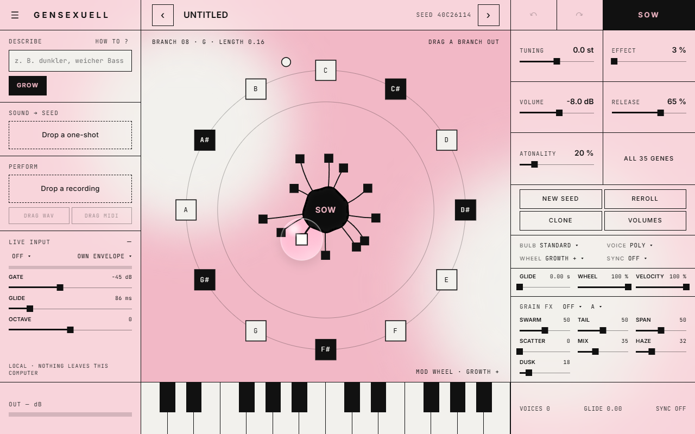

# gensexuell

[](https://github.com/Beatsex/gensexuell/actions/workflows/build.yml) [](LICENSE) 

**English** · [Deutsch](README.de.md) · [Español](README.es.md) · [Français](README.fr.md) · [日本語](README.ja.md)

A synthesizer you grow from a seed, by **beatsexuell**.
VST3, CLAP and LV2 on Windows and macOS, AU on macOS, plus a standalone app. Everything runs on your computer: no cloud, no account, no internet connection.

> Grow sounds, don't generate songs.



## Install

Download the latest build from [Releases](https://github.com/Beatsex/gensexuell/releases).

| System | How |
|---|---|
| Windows 10 / 11 (64-bit) | Run `gensexuell-…-win64-setup.exe`. The beta is not code-signed yet: if SmartScreen appears, click *More info* → *Run anyway*. The interface needs the Microsoft WebView2 Runtime; Windows 11 includes it, and the setup tells you if it is missing. |
| macOS | Copy `gensexuell.vst3` to `~/Library/Audio/Plug-Ins/VST3`, `gensexuell.component` to `~/Library/Audio/Plug-Ins/Components` and `gensexuell.clap` to `~/Library/Audio/Plug-Ins/CLAP`. The macOS build has not been tested by hand yet. |

Then restart your DAW (or rescan plugins) and insert it as an instrument: *beatsexuell → gensexuell*.

## Quick start

1. Play a few notes, on your keyboard or on the keys in the window.
2. Drag a branch out of the seed. The longer the branch, the further the sound moves.
3. Found one you like? Click **SOW** to make it the new seed, and repeat.
4. Or type *"dark soft bass"* on the left and click **GROW**.
5. Or drop a one-shot on **Sound → Seed**.

## Documentation

- **User manual**: [online](https://beatsex.github.io/gensexuell/manual.html), German: [Handbuch](https://beatsex.github.io/gensexuell/handbuch.html). Both also come with every download.
- **Describing sounds**: the [Describe guide](docs/DESCRIBE.md), and the [interactive guide](https://beatsex.github.io/gensexuell/) to try the parser and browse every word.
- **What changed**: [CHANGELOG.md](CHANGELOG.md).

## Features

- **Three ways to a sound**
  - **Grow it**: 12 branches around a seed, each longer branch further from the original. Sow, clone, reroll, undo.
  - **Describe it**: type what you want in German or English (*"dark, soft bass"*, *"wärmeres Pad mit viel Raum"*). gensexuell searches for seeds that actually sound that way. Four takes per click.
  - **Bring a sample**: drop a one-shot. A neural net guesses the genes, four strands refine the match while you listen.
- **Performance → seed**: drop a monophonic recording (vocals, humming, bass). It finds notes, timing, dynamics and bends and plays them with the current seed. Drag the result into your DAW as WAV or MIDI.
- **Live input**: route audio to the sidechain and play the synth with your voice or an instrument in real time.
- **54 genes** in a gene editor, with ring modulation, wavefolding and stepped random pitch at their far ends
- **Bulb modes** (standard, velocity, ranges, layered), poly / mono / legato with glide, branch volumes
- **Mod wheel ring** with ten targets, tempo sync, MPE basics
- **Grain effects** from [grainsexuell](https://github.com/Beatsex/grainsexuell): Mosaic, Cloud, Shard, Tap, plus Haze reverb and Dusk low-pass
- **Patches**: 12 factory sounds, patch files, programs, **MIDI learn**
- On-screen keyboard, output meter, resizable window

## Feedback

Open an [issue](https://github.com/Beatsex/gensexuell/issues) with the patch or seed, what you played, what you heard, your DAW and sample rate. For a crash: which DAW and what you clicked last.

## Build from source

Requirements: CMake 3.22+, a C++20 compiler (Visual Studio 2022 or Xcode). JUCE 8 and clap-juce-extensions go into `libs/`, at the versions pinned in [`.github/workflows/build.yml`](.github/workflows/build.yml). Windows also needs the NuGet package `Microsoft.Web.WebView2` version `1.0.3485.44` in `libs/nuget`.

```
cmake -B build -G "Visual Studio 17 2022" -A x64   # or: cmake -B build -DCMAKE_BUILD_TYPE=Release
cmake --build build --config Release -j
ctest --test-dir build -C Release --output-on-failure
```

The plugin ends up in `build/Seedling_artefacts/Release/`. On Windows, `build.cmd` does all of this with the Visual Studio Build Tools.

Windows installer: `py installer\make-source.py`, then `"C:\Program Files (x86)\Inno Setup 6\ISCC.exe" installer\gensexuell.iss`. The setup lands in `build\installer`.

The sound → seed net is trained from the engine itself: `tools\dataset.cmd 150000`, then `py tools/train/train.py`. Retrain whenever the genes or the voice DSP change.

## License

[GNU AGPL v3](LICENSE) © beatsexuell. You may use, change and share gensexuell; whoever passes it on, changed or not, passes on the source too.

It uses JUCE 8 under its AGPLv3 option, clap-juce-extensions (MIT), the grainsexuell effects (MIT) and the fonts Inter and JetBrains Mono (SIL OFL 1.1), see [THIRD-PARTY-LICENSES.txt](THIRD-PARTY-LICENSES.txt).
